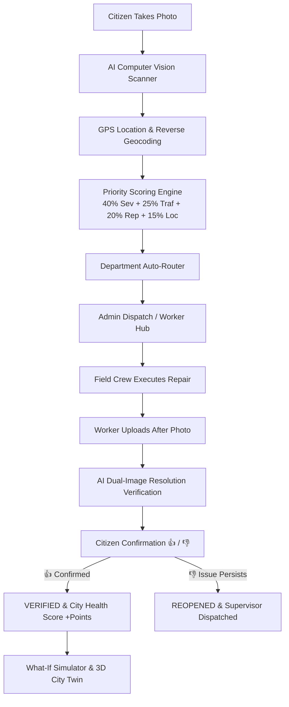

# 🚀 AI CivicFix — AI-Powered Civic Problem Reporting & Resolution Platform

> An autonomous smart city platform integrating **Computer Vision defect detection**, **4-factor municipal priority scoring**, **3D Digital Twin City visualization (Three.js)**, **dual-image AI resolution verification**, and an **interactive What-If Simulator**.

---

## 🌟 The Complete Civic Lifecycle



---

## 🗂️ 7 Supported Civic Categories

| Icon | Category | Department Routed | Baseline SLA | Defect Signature |
|:---:|:---|:---|:---:|:---|
| 🕳️ | **Pothole** | Road Maintenance | 48 hrs | Asphalt craters, depressions, rim breaks |
| 🗑️ | **Garbage** | Sanitation Department | 24 hrs | Refuse dump, overflowing bins, sidewalk waste |
| 💡 | **Streetlight** | Electrical Department | 36 hrs | Damaged pole, dark luminaire, unlit junction |
| 💧 | **Water Leak** | Water Supply Department | 12 hrs | Pipe burst, potable main rupture, road ponding |
| 🚰 | **Drainage** | Drainage Department | 24 hrs | Blocked stormwater conduit, silt overflow |
| 🌳 | **Fallen Tree** | Disaster & Forest | 8 hrs | Fallen timber, branches blocking carriage lanes |
| 🚦 | **Traffic Signal** | Traffic Management | 12 hrs | Amber blink, stuck phases, controller fault |

---

## 🚀 Key Innovations & Features

### 1. 🏙️ 3D Digital Twin City ("Wow Factor" with Three.js)
- **Procedural 3D City Architecture**: Smart-city high-rises, road networks, and municipal towers.
- **Dynamic Traffic Simulation**: Autonomous moving vehicles with headlights and taillights navigating road grids.
- **Pulsing 3D Problem Beacons**: Glowing beacons directly mapped to real coordinates:
  - Red pulsing rings for Critical Potholes
  - Amber sparks for Damaged Streetlights
  - Aqua wave ripples for Water Pipeline Breaches
  - Orange biohazard markers for Garbage Heaps
- **Interactive Raycasting & Camera Fly-To**: Clicking any 3D problem smoothly animates the camera to frame it at a dramatic angle and pops up a holographic inspection card.
- **Cyber Night / Day View Toggle**: Dynamic lighting and neon emission modes.

### 2. 🧮 4-Factor Municipal Priority Scoring Engine
Implements the exact municipal formula normalized to `0–100`:
$$\text{Priority Score} = (\text{Severity} \times 40\%) + (\text{Traffic Level} \times 25\%) + (\text{Report Count} \times 20\%) + (\text{Location Importance} \times 15\%)$$

- **Emergency Corridor Mode**: Overrides score to `98/100` (immediate dispatch) when marked near hospitals or critical emergency routes.

### 3. 🤖 Dual-Image AI Resolution Verification
- When a field worker completes repairs, they upload a **Post-Repair (After) Photo**.
- The AI resolution engine compares the Before and After imagery to verify defect clearance (e.g. `94% Confidence: Zero pothole craters detected, planar compacted asphalt grade restored`).
- If AI confidence falls below 80%, the system automatically flags `Manual Supervisor Audit Required`.

### 4. 🔮 What-If Municipal Simulator (City Planner Lab)
- Allows administrators to simulate outcomes of municipal interventions before spending public funds.
- **Scenarios**:
  - *"Repair 10 Highest-Priority Potholes"*
  - *"Sanitation Fleet Blitz in Commercial Zones"*
  - *"Pre-Monsoon Drainage Culvert Desilting"*
- **Predicted Outputs**:
  - Complaint Drop % (e.g. `↓ 23%`)
  - Traffic Congestion Impact Reduction (e.g. `↓ 14%`)
  - City Health Score Increase (e.g. `71 → 77, +6 points`)
  - Estimated Budget & Turnaround Days

### 5. 💬 AI Civic Copilot
- Conversational chat drawer accessible on all pages.
- Grounded directly in live database queries (not invented stats):
  - *"Which area has the most unresolved problems?"*
  - *"How many potholes are unresolved?"*
  - *"What is our slowest department?"*
  - *"What is our current City Health Score?"*

### 6. 👍 Citizen Confirmation Feedback Loop
- Once marked `RESOLVED`, the citizen inspects the repair through an interactive **Before/After split slider**.
- 👍 **Yes**: Celebrates with confetti and marks status `VERIFIED`.
- 👎 **No**: Instantly reverts complaint to `REOPENED` with custom feedback and notifies field leads.

---

## 🏗️ System Architecture

```
civicfix/
│
├── frontend/                     # React 18 + Vite + Tailwind CSS + Three.js + Leaflet
│   ├── src/
│   │   ├── components/
│   │   │   ├── 3d/City3D.jsx     # Interactive Three.js 3D Smart City Digital Twin
│   │   │   ├── map/CivicMap.jsx  # Interactive Leaflet 2D Map with Custom Markers
│   │   │   ├── common/           # Navbar, BeforeAfterSlider
│   │   │   └── copilot/          # AI Civic Copilot Floating Drawer
│   │   ├── pages/
│   │   │   ├── ReportProblem.jsx    # Photo scan, GPS capture & intake
│   │   │   ├── CitizenDashboard.jsx # Progress timeline & confirmation loop
│   │   │   ├── AdminDashboard.jsx   # City Health score & worker dispatch
│   │   │   ├── WorkerDashboard.jsx  # Task execution & proof verification
│   │   │   └── WhatIfSimulator.jsx  # Predictive municipal policy lab
│   │   ├── context/              # AuthContext & NotificationContext
│   │   └── api/client.js         # REST API Client
│   └── package.json
│
├── backend/                      # Node.js + Express + Embedded SQLite/JSON Engine
│   ├── src/
│   │   ├── controllers/          # Auth, Complaints, AI, Analytics, Simulator
│   │   ├── routes/               # Express REST Route Handlers
│   │   ├── services/             # AI Vision, Priority Engine, Department Router
│   │   ├── models/db.js          # Persistent Database Engine with Rich Seeds
│   │   └── server.js             # Express Server on Port 5000
│   └── package.json
│
├── ai-service/                   # Python FastAPI + YOLOv8 Microservice
│   ├── main.py                   # FastAPI Application (/predict, /verify-resolution)
│   ├── detector.py               # YOLOv8 Civic Problem Classifier
│   ├── verifier.py               # Computer Vision Resolution Verifier
│   └── requirements.txt
│
├── database/
│   ├── schema.sql                # Production PostgreSQL Schema & DDL
│   └── seeds.sql                 # Sample Reference SQL Data
│
└── package.json                  # Root runner script
```

---

## ⚡ Quick Start & Run Guide

### 1. Start the Backend API (Port 5000)
```bash
cd backend
npm install
npm start
```
*Health check:* `http://localhost:5000/api/health`

### 2. Start the Frontend (Port 3000)
In a new terminal:
```bash
cd frontend
npm install
npm run dev
```
Open **`http://localhost:3000`** in your browser.

### 3. (Optional) Run the Standalone Python AI Service (Port 8000)
The Node.js backend includes an intelligent embedded Computer Vision pipeline that runs out of the box with zero external dependencies. If you wish to run the standalone Python FastAPI YOLO service:
```bash
cd ai-service
python -m venv venv
# Windows:
.\venv\Scripts\activate
# Linux/macOS:
source venv/bin/activate

pip install -r requirements.txt
uvicorn main:app --reload --port 8000
```

---

## 👥 Demo Personas (1-Click Switcher)

You can switch between roles instantly from the top-right role dropdown in the app:
1. **Citizen**: `Aarav Sharma` (`citizen@civicfix.org` / `citizen123`) — Report defects, track lifecycle, confirm fixes.
2. **Municipal Admin**: `Dr. Sarah Mukherjee` (`admin@civicfix.org` / `admin123`) — Monitor City Health Score, dispatch crews, emergency modes.
3. **Field Worker**: `Rajesh Verma` (`worker@civicfix.org` / `worker123`) — Start work, upload After proof, run AI verification.

---

## 📄 License
MIT License. Built for modern AI-driven municipal governance and smart cities.
